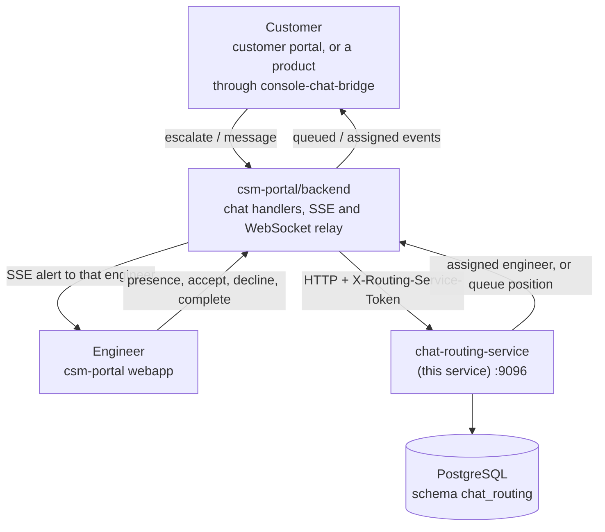

# Chat Routing Service

Decides which support engineer picks up a live-chat escalation. Each
escalation goes to exactly one engineer, the one with the most spare
capacity, instead of being broadcast to everyone. When every engineer is
busy, the customer waits in a first-in, first-out queue that drains
automatically as engineers free up.

The service is called only by `csm-portal/backend`, which owns every
browser connection (SSE to engineers, WebSocket to customers) and relays
this service's decisions over them. Engineer presence, the waiting queue
and chat sessions are stored in PostgreSQL, so restarting the service loses
no routing state.

## Contents

- [Quick Start](#quick-start)
- [Overview](#overview)
- [Architecture](#architecture)
- [Prerequisites](#prerequisites)
- [Configuration](#configuration)
- [Database setup](#database-setup)
- [Testing](#testing)
- [Project Structure](#project-structure)
- [API Endpoints](#api-endpoints)
- [How routing works](#how-routing-works)
- [Data model](#data-model)
- [Known limitations](#known-limitations)

## Quick Start

```bash
# from apps/chat-routing-service/backend
cp .env.example .env   # then fill in the values, see Configuration
go run ./cmd/server
```

The service listens on port `9096` by default. `GET /health` returns
`200 OK` once it is up.

## Overview

- **One engineer per escalation.** An escalation is assigned to the
  available engineer with the fewest active chats; ties go to whoever has
  accepted the fewest chats today, then to whoever has been available
  longest.
- **Concurrent chats.** Each engineer sets how many chats they can hold at
  once (`max_concurrent_chats`, 1 to 10, default 1).
- **Queueing.** If nobody has spare capacity, the escalation waits in the
  queue. The customer is told their position, and the oldest waiting chat
  is assigned as soon as an engineer frees up.
- **Accept, decline and timeouts.** A newly assigned chat is *pending*
  until the engineer accepts it. A decline, or no answer within the pending
  timeout, passes the chat to the next engineer or puts it back in the
  queue at its original position.
- **Presence.** Each engineer chooses `AVAILABLE`, `BUSY` or `OFFLINE`.
  `BUSY` and `OFFLINE` stop new assignments but never drop chats the
  engineer already holds.

Engineers are identified by their identity provider's `userid` claim. The
service stores no user profile data.

## Architecture



Every call into this service is a synchronous HTTP request from
`csm-portal/backend`. This service never opens a connection to a browser.

## Prerequisites

- Go 1.26 or later
- PostgreSQL. The service uses its own `chat_routing` schema, and can share
  a database with `entity-service` or have one to itself.
- [golang-migrate](https://github.com/golang-migrate/migrate) CLI, to apply
  the migrations

## Configuration

Settings are read from environment variables. A `.env` file in this
directory is loaded first if present; see `.env.example`.

| Variable | Default | Description |
|---|---|---|
| `ROUTING_SERVICE_PORT` | `9096` | Port to listen on (a bare number). |
| `ROUTING_SERVICE_TOKEN` | — | Shared secret sent by `csm-portal/backend` in the `X-Routing-Service-Token` header. Must match that service's `ROUTING_SERVICE_TOKEN`. Generate one with `openssl rand -hex 24`. |
| `PENDING_TIMEOUT_SECONDS` | `90` | How long an assigned chat can wait for the engineer to accept before it is passed on. |
| `QUEUE_ABANDON_SECONDS` | `1800` | How long a chat can wait in the queue, never assigned, before it is given up. |
| `ACCEPTED_SESSION_IDLE_SECONDS` | `1800` | How long an accepted chat can go with no activity before it is ended. |
| `DB_HOST`, `DB_PORT`, `DB_NAME` | `DB_PORT=5432` | PostgreSQL connection. |
| `DB_USER`, `DB_PASSWORD` | — | PostgreSQL credentials. |
| `DB_SSLMODE` | `disable` | PostgreSQL SSL mode. |

The timeouts are enforced by `POST /route/sweep-timeouts`, which
`csm-portal/backend` calls periodically.

`ROUTING_SERVICE_TOKEN` is a server-to-server secret. Never send it to, or
build it into, browser code.

## Database setup

All tables live in the `chat_routing` schema, and each connection's
`search_path` is set to it, so queries use unqualified table names.

1. If `DB_USER` does not own the database, allow it to create the schema:

   ```bash
   psql -h localhost -U <admin-user> -d <db-name> \
     -c "GRANT CREATE ON DATABASE <db-name> TO <db-user>;"
   ```

2. Apply the migrations. Use a dedicated tracking table so the history
   doesn't collide with another service's migrations in the same database:

   ```bash
   migrate -path migrations \
     -database "postgres://<db-user>:<db-password>@localhost:5432/<db-name>?sslmode=disable&x-migrations-table=chat_routing_schema_migrations" \
     up
   ```

Migrations are forward-only once applied: a schema change is always a new
file, never an edit to an existing one. For the current schema in one
place, see [`current_schema.sql`](./current_schema.sql), a generated
snapshot that is not applied by anything.

## Testing

```bash
# from apps/chat-routing-service/backend
go test ./...
```

The router tests run against the database configured by the `DB_*`
variables and are skipped when it isn't configured. They create their own
engineers and chats. Engineers already marked `AVAILABLE` in the same
database can win assignments the tests expect, so point the tests at a
database with no real engineers in it.

`test-multi-engineer-routing.sh` is a manual end-to-end check against a
running service. It covers least-busy ranking, tie-breaks and decline
reassignment, using made-up engineer and case IDs.

## Project Structure

```text
backend/
├── cmd/server/main.go           # Entry point: config, routes, server
├── internal/
│   ├── config/                  # Environment and database settings
│   ├── db/                      # Connection pool (sets search_path)
│   ├── handler/routes.go        # HTTP handlers for /route/*
│   ├── middleware/              # Token auth, request logging, security headers
│   └── router/                  # Routing logic and all database access
│       ├── state.go             # Escalate, presence, accept, decline, complete
│       ├── timeout.go           # Pending, queue and idle-session sweeps
│       ├── workitem.go          # Chat work items and the message transcript
│       └── types.go             # Shared request/result types
├── migrations/                  # golang-migrate files (.up/.down)
├── current_schema.sql           # Generated snapshot of the current schema
├── openapi.yaml                 # OpenAPI 3.0 description of the API
└── test-multi-engineer-routing.sh
```

A small Go client for this API lives in
[`../sdk-go/routingclient`](../sdk-go/routingclient). It is optional: any
service can call the HTTP API directly using [`openapi.yaml`](./openapi.yaml).

## API Endpoints

Every `/route/*` request needs the `X-Routing-Service-Token` header.
`GET /health` needs no authentication. Request bodies are JSON, capped at
64 KiB. A database error returns `502`; the details are logged, not
returned. `userId` is always the engineer's identity-provider `userid`.

### Routing

| Method | Path | Body | Response |
|---|---|---|---|
| `POST` | `/route/escalate` | Case details | `{engineerId}`, or `{queued: true, position}` |
| `POST` | `/route/accept` | `{userId, caseId}` | `{applied}` — `false` if the chat was already declined, reassigned or accepted |
| `POST` | `/route/decline` | `{userId, caseId}` | `{reassignedTo?, requeued?, assignedCase?}` |
| `POST` | `/route/completed` | `{userId, caseId}` | `{ended, assignedCase?}` — the freed slot may be filled from the queue immediately |
| `POST` | `/route/end-by-tenant` | `{caseId, tenantSlug}` | `{ended, assignedCase?, assignedEngineerId?}` — ends a chat from the customer's side; `ended` is false if the chat isn't open or belongs to another tenant |
| `POST` | `/route/convert-to-case` | `{userId, caseId, entityCaseId}` | `{assignedCase?}` — ends the chat and records the support case it became |
| `POST` | `/route/sweep-timeouts` | — | `{results, abandoned, stale}` — chats passed on after the pending timeout, chats given up from the queue, and idle chats ended |

### Engineers

| Method | Path | Body | Response |
|---|---|---|---|
| `POST` | `/route/presence` | `{userId, status}` with `status` `AVAILABLE`, `BUSY` or `OFFLINE` | `{applied, assignedCases?}` — going `AVAILABLE` can pick up several queued chats at once |
| `GET` | `/route/presence/{userId}` | — | `{chatStatus, activeChats, maxConcurrentChats, atCapacity, cases, pendingTimeoutSeconds}`. An unknown engineer is reported as `OFFLINE` with capacity 1. |
| `PATCH` | `/route/capacity` | `{userId, maxConcurrentChats}` (1–10) | `{assignedCases?}` — raising the limit while `AVAILABLE` picks up queued chats straight away. Lowering it never drops a held chat. |

### Chats and messages

| Method | Path | Body / query | Response |
|---|---|---|---|
| `POST` | `/route/workitem` | Case details | Creates the chat record for a new escalation |
| `POST` | `/route/workitem/{caseId}/info` | — | Case details with the message transcript; `404` if unknown |
| `POST` | `/route/comment` | Message | Adds a message to a chat's transcript |
| `GET` | `/route/open-chat` | `?customerEmail=&projectId=` | The customer's chat that hasn't ended, if any (used to resume a chat after a page reload) |
| `GET` | `/route/active-chats` | — | Every accepted chat that hasn't ended, with when its engineer last replied |

### Diagnostics

| Method | Path | Response |
|---|---|---|
| `GET` | `/route/debug/state` | Engineers (status, capacity, active and today's counts) and the waiting queue |
| `GET` | `/route/debug/workitem/{caseId}` | One chat's stored record |
| `GET` | `/health` | `200 OK` |

Full request and response schemas are in [`openapi.yaml`](./openapi.yaml).

## How routing works

### Choosing an engineer

`POST /route/escalate` runs in a single database transaction and picks the
first engineer that matches, going down this list:

1. `AVAILABLE` engineers with spare capacity (active chats below their
   `max_concurrent_chats`), fewest active chats first.
2. On a tie, the one who has accepted the fewest chats today. This is
   counted live from the chat records, so declined chats don't count.
3. On a further tie, the one who has been `AVAILABLE` longest.
4. If nobody qualifies, the chat is queued and the customer gets their
   position.

Engineer rows are locked with `FOR UPDATE SKIP LOCKED`, so two concurrent
escalations can never get the same free slot. There is no "same engineer as
last time" preference.

"Today" is the database server's `CURRENT_DATE`, so the day boundary
follows that server's time zone.

### Chat lifecycle

| Event | What happens |
|---|---|
| Assigned | The chat is pending for that engineer. |
| Accepted | The chat becomes active and leaves the queue. Other chats the engineer holds are unaffected. |
| Declined | The chat goes to the next engineer by the same ranking (never back to the one who declined), or back into the queue at its original position. |
| Not accepted in time | Same as a decline. The engineer's presence is not changed. |
| Completed or ended | The engineer's slot is freed. If they are still `AVAILABLE`, the oldest queued chat is assigned to them. |
| Queued too long | The chat is removed from the queue so it can't be assigned later. |
| Idle too long | An accepted chat with no activity is ended. |

A queued chat keeps its original arrival time when it is put back, so it
stays ahead of newer chats without a separate priority flag.

## Data model

| Table | Holds |
|---|---|
| `cs_engineer_status` | One row per engineer: `user_id`, `chat_status`, `max_concurrent_chats`, `available_since` |
| `chat_conversation` | One row per chat: case and conversation IDs, `assignee_id`, `state` (`OPEN`, then `ACTIVE` once accepted), `accepted_at`, `session_ended_at`, and the case details as JSON. This is the source of truth for which chats an engineer holds. |
| `chat_queue` | One row per chat that hasn't been accepted yet, `WAITING_FOR_ENGINEER` or `ASSIGNED`, ordered by arrival time |
| `chat_queue_engineer_assignment` | Append-only history of outcomes: `CONNECTED`, `REJECTED` or `TIMED_OUT`, per engineer and case |
| `work_item`, `comment` | The chat's work item and its message transcript |

Relationships inside the schema are enforced with foreign keys. IDs that
belong to other services (such as the support case a chat was converted
into) are stored without foreign keys, so this schema doesn't depend on
another service's migrations.

## Known limitations

- **Interim message storage.** Chat work items and messages are kept in
  this service (`internal/router/workitem.go`) until an equivalent in
  `entity-service` is available. The `/route/workitem`, `/route/comment`
  and `/route/debug/*` endpoints may change when that happens.
- **Case details are copied.** Each chat stores its case details as JSON
  rather than reading them from the service that owns them.
- **Multiple replicas are untested.** All state changes are database
  transactions, so several instances should be safe against one database,
  but this has not been load-tested.
- **Fallback when unreachable.** If this service is down,
  `csm-portal/backend` broadcasts new escalations to every connected
  engineer, so a customer is never stranded.
